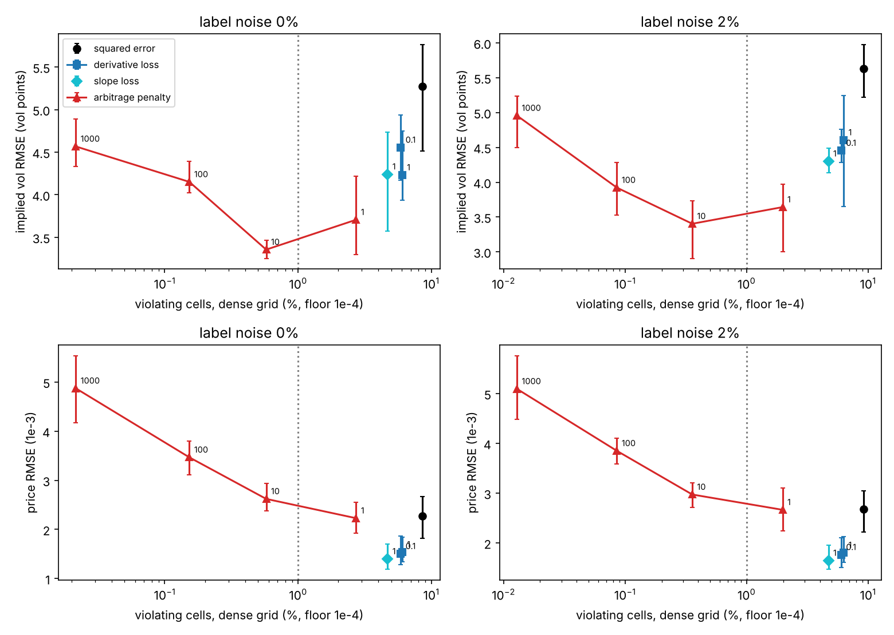

# H3 results: derivative loss against arbitrage penalty (generated by scripts/analyse_repairs.py)

48 runs. Violation target: dense-grid violating-cell rate below 1 percent. Values are means with 95 percent bootstrap intervals over seeds; the cost is paired with the squared-error control of the same seed. Read the intervals: few seeds.

## Label noise 0 percent

| method | weight | seeds | violating cells, dense (%) | surfaces violating, base (%) | IV RMSE (vol pts) | price RMSE (1e-3) | density error (scaled) | IV cost (vol pts) |
|---|---|---|---|---|---|---|---|---|
| arbitrage penalty | 1 | 3 | 2.72 [2.39, 3] | 97 [92.6, 99.5] | 3.71 [3.3, 4.22] | 2.23 [1.93, 2.55] | 0.283 [0.257, 0.302] | -1.57 [-1.93, -1.22] |
| arbitrage penalty | 10 | 3 | 0.576 [0.451, 0.668] | 57.9 [46, 64.3] | 3.36 [3.25, 3.46] | 2.62 [2.38, 2.94] | 0.3 [0.295, 0.304] | -1.92 [-2.3, -1.16] |
| arbitrage penalty | 100 | 3 | 0.153 [0.109, 0.207] | 27.3 [18.3, 34.7] | 4.15 [4.02, 4.39] | 3.47 [3.12, 3.8] | 0.338 [0.315, 0.353] | -1.12 [-1.51, -0.475] |
| arbitrage penalty | 1000 | 3 | 0.0215 [0.0161, 0.0284] | 3.57 [1.58, 5.03] | 4.57 [4.33, 4.89] | 4.87 [4.18, 5.54] | 0.363 [0.32, 0.386] | -0.704 [-1.43, 0.376] |
| derivative loss | 0.1 | 3 | 5.88 [5.72, 6.1] | 97.8 [96.6, 98.9] | 4.56 [4.17, 4.94] | 1.5 [1.28, 1.87] | 0.149 [0.122, 0.194] | -0.717 [-0.982, -0.343] |
| derivative loss | 1 | 3 | 6.03 [5.66, 6.64] | 97.2 [94.4, 98.6] | 4.23 [3.93, 4.75] | 1.54 [1.34, 1.84] | 0.069 [0.0575, 0.0836] | -1.04 [-1.52, -0.582] |
| slope loss | 1 | 3 | 4.69 [4.38, 5] | 97.4 [95, 99.4] | 4.24 [3.57, 4.73] | 1.4 [1.19, 1.71] | 0.175 [0.164, 0.182] | -1.03 [-1.12, -0.94] |
| squared error | 0 | 3 | 8.57 [5.74, 11.5] | 99.6 [98.7, 100] | 5.27 [4.51, 5.76] | 2.27 [1.82, 2.67] | 0.299 [0.272, 0.328] | - |

## Label noise 2 percent

| method | weight | seeds | violating cells, dense (%) | surfaces violating, base (%) | IV RMSE (vol pts) | price RMSE (1e-3) | density error (scaled) | IV cost (vol pts) |
|---|---|---|---|---|---|---|---|---|
| arbitrage penalty | 1 | 3 | 1.98 [1.82, 2.25] | 88.7 [79.6, 96.7] | 3.64 [3, 3.97] | 2.67 [2.24, 3.11] | 0.3 [0.267, 0.324] | -1.99 [-2.69, -1.27] |
| arbitrage penalty | 10 | 3 | 0.357 [0.292, 0.451] | 39.4 [30.5, 46.9] | 3.4 [2.91, 3.74] | 2.97 [2.72, 3.2] | 0.311 [0.309, 0.312] | -2.23 [-2.79, -1.65] |
| arbitrage penalty | 100 | 3 | 0.0857 [0.0694, 0.116] | 13.9 [12.8, 15.8] | 3.92 [3.53, 4.29] | 3.85 [3.59, 4.11] | 0.349 [0.331, 0.362] | -1.71 [-2.16, -1.27] |
| arbitrage penalty | 1000 | 3 | 0.0129 [0.00771, 0.0162] | 2.9 [1.85, 4.57] | 4.96 [4.5, 5.24] | 5.1 [4.48, 5.76] | 0.369 [0.331, 0.392] | -0.674 [-1.19, 0.0171] |
| derivative loss | 0.1 | 3 | 6.01 [5.6, 6.58] | 96.2 [95.5, 96.9] | 4.45 [4.28, 4.76] | 1.76 [1.51, 2.11] | 0.125 [0.101, 0.161] | -1.18 [-1.65, -0.465] |
| derivative loss | 1 | 3 | 6.29 [5.03, 7.31] | 97.5 [94.5, 99.8] | 4.61 [3.65, 5.24] | 1.81 [1.61, 2.13] | 0.0683 [0.057, 0.0835] | -1.03 [-1.58, -0.452] |
| slope loss | 1 | 3 | 4.71 [4.3, 5.18] | 97.5 [96.4, 99.2] | 4.3 [4.14, 4.49] | 1.65 [1.47, 1.96] | 0.18 [0.167, 0.191] | -1.33 [-1.84, -0.731] |
| squared error | 0 | 3 | 9.2 [5.46, 11.3] | 98.6 [95.9, 100] | 5.63 [5.22, 5.98] | 2.67 [2.23, 3.05] | 0.322 [0.286, 0.353] | - |

## Weights reaching the target, and the cheapest of them

Noise 0 percent:

- derivative loss: no weight reached the target
- arbitrage penalty: weight 10, IV cost -1.92 [-2.3, -1.16] vol points, price cost 0.348 [0.0555, 0.718] (1e-3), violating cells 0.576 [0.451, 0.668] percent

Noise 2 percent:

- derivative loss: no weight reached the target
- arbitrage penalty: weight 10, IV cost -2.23 [-2.79, -1.65] vol points, price cost 0.299 [-0.0289, 0.775] (1e-3), violating cells 0.357 [0.292, 0.451] percent

